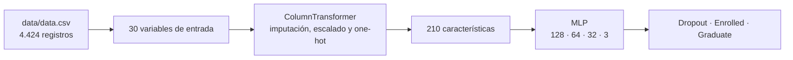
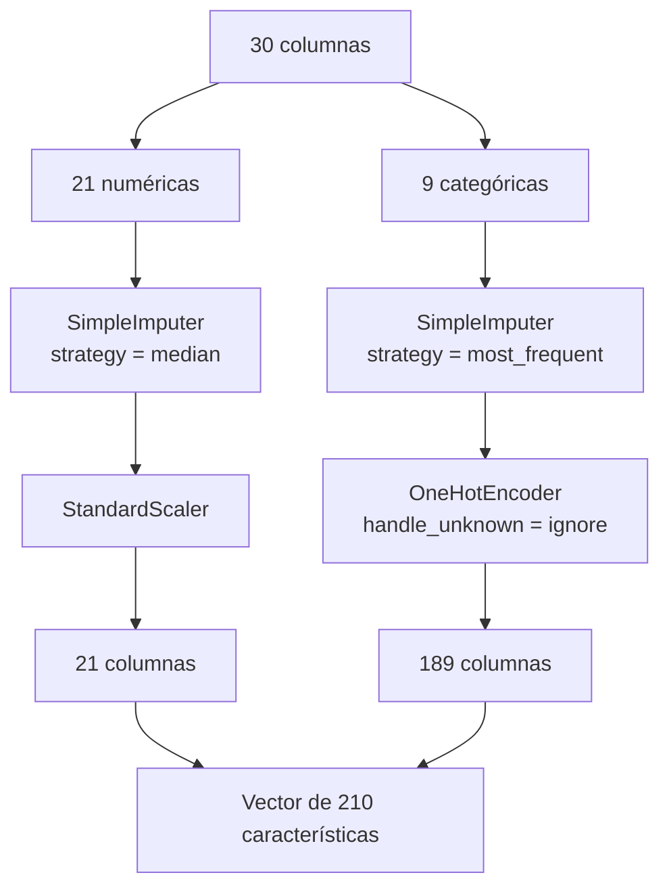
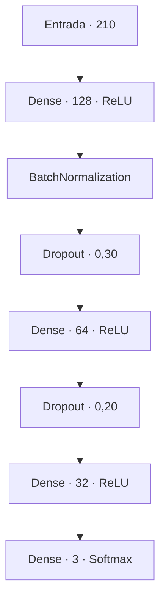
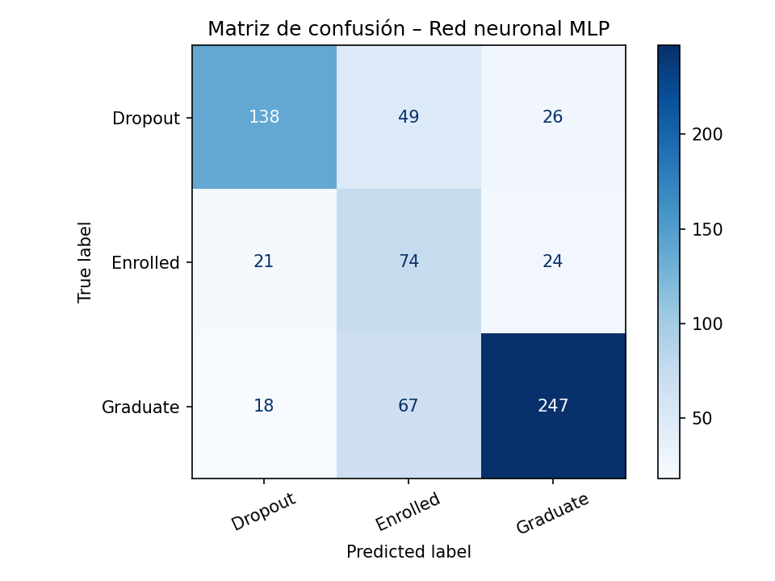
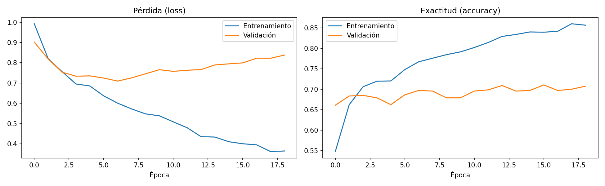

# Predicción de deserción estudiantil

Aplicación académica que estima el resultado de un estudiante de educación superior —deserción, continuidad o graduación— con una red neuronal multicapa (MLP). El modelo se entrenó para apoyar la prevención temprana: usa información disponible al cierre del primer semestre y deja fuera las variables del segundo semestre.

**Corporación Unificada Nacional de Educación Superior (CUN)**  
Escuela de Ingeniería · Especialización en Inteligencia Artificial  
Aprendizaje Automático · ACA N.º 2

---

## Tabla de contenido

1. [Descripción general](#1-descripción-general)
2. [Contexto y problemática](#2-contexto-y-problemática)
3. [Objetivos](#3-objetivos)
4. [Fuente y descripción del dataset](#4-fuente-y-descripción-del-dataset)
5. [Características de los datos](#5-características-de-los-datos)
6. [Preparación y preprocesamiento](#6-preparación-y-preprocesamiento)
7. [Arquitectura de la red neuronal MLP](#7-arquitectura-de-la-red-neuronal-mlp)
8. [Configuración y proceso de entrenamiento](#8-configuración-y-proceso-de-entrenamiento)
9. [Resultados y métricas de evaluación](#9-resultados-y-métricas-de-evaluación)
10. [Análisis de la matriz de confusión](#10-análisis-de-la-matriz-de-confusión)
11. [Curvas de aprendizaje y sobreajuste](#11-curvas-de-aprendizaje-y-sobreajuste)
12. [Aplicación desarrollada con Streamlit](#12-aplicación-desarrollada-con-streamlit)
13. [Estructura de carpetas](#13-estructura-de-carpetas)
14. [Instalación y configuración](#14-instalación-y-configuración)
15. [Ejecución de la aplicación](#15-ejecución-de-la-aplicación)
16. [Tecnologías y librerías](#16-tecnologías-y-librerías)
17. [Limitaciones y mejoras futuras](#17-limitaciones-y-mejoras-futuras)
18. [Integrantes](#18-integrantes)

---

## 1. Descripción general

El proyecto entrega dos piezas:

- Un **modelo MLP** guardado en `models/`, junto con el preprocesador y los metadatos necesarios para transformar una ficha de estudiante.
- Una **aplicación web en Streamlit** (`app.py`) que recoge 30 variables, las transforma con el mismo preprocesador del entrenamiento y muestra la clase estimada, su probabilidad y la distribución entre las tres clases.

La evaluación queda registrada en `outputs/`: métricas globales, matriz de confusión y curvas de pérdida y exactitud.



El repositorio **no incluye el notebook de entrenamiento**. Las secciones de preprocesamiento, arquitectura y métricas describen los artefactos que sí están versionados: el preprocesador, el modelo Keras, los metadatos, el CSV de métricas y las figuras de `outputs/`.

---

## 2. Contexto y problemática

La deserción estudiantil es el abandono de un programa antes de obtener el título. Detectarla tarde reduce el margen de una tutoría, un ajuste de carga académica o un apoyo financiero. Esperar al segundo semestre, o al cierre del año, entrega una señal más precisa y, al mismo tiempo, llega cuando parte del daño ya ocurrió.

Este trabajo aborda el problema como una **clasificación multiclase**, no como un sí o no de deserción. Un estudiante puede estar en una de tres situaciones:

| Clase en los datos | Significado en la aplicación |
| --- | --- |
| `Dropout` | Deserción estudiantil |
| `Enrolled` | Continúa matriculado |
| `Graduate` | Graduación |

Las tres clases están desbalanceadas. En el conjunto completo, graduación concentra casi la mitad de los casos y «continúa matriculado» es la clase minoritaria. Un modelo que solo optimice la exactitud global puede verse bien y, aun así, fallar justo en el grupo que más interesa acompañar.

La decisión de diseño central está guardada en `models/metadata.joblib`: se excluyen las seis variables del segundo semestre. Así la predicción se apoya en admisión, contexto y desempeño del primer semestre, que es la ventana en la que una institución todavía puede intervenir.

---

## 3. Objetivos

### Objetivo general

Estimar, con una red neuronal MLP, si un estudiante desertará, continuará matriculado o se graduará, a partir de información disponible al finalizar el primer semestre, y disponibilizar esa estimación en una aplicación de consulta.

### Objetivos específicos

- Preparar el conjunto de 4.424 registros y 37 columnas, separando la variable objetivo y dejando fuera el segundo semestre.
- Transformar 30 variables de entrada en un vector numérico de 210 características, con imputación, escalado y codificación one-hot.
- Entrenar un MLP con capas densas de 128, 64 y 32 neuronas y una salida softmax de 3 clases.
- Evaluar el modelo con exactitud, precisión, recall y F1 macro, y revisar la matriz de confusión y las curvas de aprendizaje.
- Comparar el F1 macro del MLP con los modelos del ACA 1: regresión logística, random forest y árbol de decisión.
- Publicar una interfaz Streamlit que traduzca los códigos del dataset y presente la predicción como una probabilidad, no como una certeza.

---

## 4. Fuente y descripción del dataset

Los datos viven en dos copias con el mismo contenido:

| Ubicación | Formato | Uso en este proyecto |
| --- | --- | --- |
| `data/data.csv` | CSV separado por punto y coma | Fuente que lee `app.py` |
| `aca2_desercion.db` | SQLite, tabla `estudiantes` | Copia tabular del mismo conjunto |

Ambas copias tienen **4.424 filas y 37 columnas**, sin valores nulos y sin filas duplicadas. Después de limpiar el nombre de una columna, los valores coinciden.

El encabezado `Daytime/evening attendance` llega en el CSV con un carácter de tabulación al final. La aplicación hace `strip()` sobre los nombres al cargar el archivo. En la base SQLite ese nombre ya está limpio.

El repositorio **no incluye una cita bibliográfica ni la URL de descarga**. Lo que sí está en el código y en los datos permite describir el origen temático con precisión:

- Los nombres de columna están en inglés y la variable objetivo se llama `Target`.
- La nacionalidad está codificada; en la interfaz, el código 1 corresponde a nacionalidad portuguesa y aparecen códigos de varios países.
- Las modalidades de ingreso mencionan cupos de Azores y Madeira, convocatorias por fases y vías de la educación superior portuguesa.
- Los niveles educativos previos usan la nomenclatura de ese sistema (12.º año, ciclos de educación básica, cursos técnicos superiores).

Las etiquetas en español de esos códigos están definidas en `app.py` (`LABELS`, `CATEGORY_LABELS`, `BINARY_LABELS` y `CLASS_LABELS`). El modelo sigue recibiendo el código numérico original.

La aplicación **no consulta** `aca2_desercion.db`. La base documenta y conserva el dataset; la inferencia usa `data/data.csv` solo para armar los controles del formulario (valores presentes, mínimos, máximos y medianas) y los archivos de `models/` para predecir.

---

## 5. Características de los datos

| Dato | Valor verificado |
| --- | --- |
| Registros | 4.424 |
| Columnas | 37 |
| Valores nulos | 0 |
| Filas duplicadas | 0 |
| Clases de `Target` | 3: `Dropout`, `Enrolled`, `Graduate` |
| Variables usadas por el modelo | 30 |
| Variables excluidas | 6, todas del segundo semestre |
| Separador del CSV | `;` |

### Distribución de la clase objetivo

| Clase | Registros | Proporción |
| --- | ---: | ---: |
| Graduate | 2.209 | 49,93 % |
| Dropout | 1.421 | 32,12 % |
| Enrolled | 794 | 17,95 % |
| **Total** | **4.424** | **100 %** |

### Grupos de variables

Las 37 columnas se reparten así. El rol es el que quedó guardado en `metadata.joblib`.

| Grupo | Columnas | Rol en el modelo |
| --- | --- | --- |
| Ingreso y antecedentes | Estado civil, modalidad de ingreso, orden de solicitud, programa, jornada, nivel de estudios previo y su calificación, nacionalidad | 7 categóricas y 2 numéricas. `Nacionality` quedó en el grupo numérico |
| Entorno familiar | Nivel educativo y ocupación de la madre y del padre | 4 categóricas |
| Situación del estudiante | Nota de admisión, desplazamiento, necesidades educativas especiales, deudas, matrícula al día, género, beca, edad, estudiante internacional | Numéricas. Las binarias se muestran en la app como Sí/No |
| Primer semestre | Asignaturas homologadas, inscritas, evaluaciones, aprobadas, promedio y asignaturas sin evaluación | Numéricas. Sí entran al modelo |
| Contexto macroeconómico | Tasa de desempleo, tasa de inflación, PIB | Numéricas |
| Segundo semestre | Las mismas seis medidas curriculares del segundo semestre | Excluidas |
| Objetivo | `Target` | No es variable de entrada |

Nombres originales de las seis columnas excluidas:

- `Curricular units 2nd sem (credited)`
- `Curricular units 2nd sem (enrolled)`
- `Curricular units 2nd sem (evaluations)`
- `Curricular units 2nd sem (approved)`
- `Curricular units 2nd sem (grade)`
- `Curricular units 2nd sem (without evaluations)`

Variables categóricas (9), codificadas con one-hot:

`Marital status`, `Application mode`, `Course`, `Daytime/evening attendance`, `Previous qualification`, `Mother's qualification`, `Father's qualification`, `Mother's occupation`, `Father's occupation`.

Variables numéricas (21): el resto de las 30 columnas de entrada, incluida `Nacionality`.

---

## 6. Preparación y preprocesamiento

El preprocesador guardado en `models/preprocesador.joblib` es un `ColumnTransformer` de scikit-learn con dos tuberías.



| Rama | Columnas | Pasos | Salida |
| --- | ---: | --- | ---: |
| `num` | 21 | Mediana y luego estandarización | 21 |
| `cat` | 9 | Moda y luego one-hot | 189 |
| **Total** | **30** | | **210** |

Detalles que afectan la lectura del modelo:

- El dataset actual no tiene nulos. Los imputadores quedan en la tubería para la inferencia y no alteran estas 4.424 filas.
- `OneHotEncoder(handle_unknown="ignore")` convierte una categoría no vista en un vector de ceros, en lugar de lanzar un error.
- `Nacionality` se escala como número. Es un código de categoría, no una magnitud. Esa decisión está en los metadatos y se comenta de nuevo en las limitaciones.
- Las binarias (`Displaced`, `Gender`, `Debtor`, `Scholarship holder` y otras) también pasan por `StandardScaler`.
- La app construye el formulario con el orden de `feature_columns` y aplica `preprocesador.transform` antes de `modelo.predict`.

---

## 7. Arquitectura de la red neuronal MLP

El archivo `models/modelo_mlp_desercion.keras` es un modelo secuencial. La entrada tiene forma `(None, 210)` y la salida `(None, 3)`.



| Capa | Tipo | Unidades | Activación | Parámetros |
| --- | --- | ---: | --- | ---: |
| `dense` | Dense | 128 | ReLU | 27.008 |
| `batch_normalization` | BatchNormalization | 128 | — | 512 |
| `dropout` | Dropout | 128 | tasa 0,30 | 0 |
| `dense_1` | Dense | 64 | ReLU | 8.256 |
| `dropout_1` | Dropout | 64 | tasa 0,20 | 0 |
| `dense_2` | Dense | 32 | ReLU | 2.080 |
| `dense_3` | Dense | 3 | Softmax | 99 |

| Concepto | Valor |
| --- | ---: |
| Parámetros entrenables | 37.699 |
| Parámetros no entrenables | 256 |
| Parámetros del optimizador | 75.400 |
| Total informado por Keras | 113.355 |

Los 256 parámetros no entrenables son la media y la varianza móviles de la normalización por lotes (128 × 2). La capa de salida usa softmax, así que las tres probabilidades suman 1. La clase predicha es la de mayor probabilidad.

La compilación guardada en el modelo es:

| Elemento | Valor |
| --- | --- |
| Pérdida | `sparse_categorical_crossentropy` |
| Optimizador | Adam |
| Tasa de aprendizaje | 0,00025 |
| `beta_1` / `beta_2` | 0,9 / 0,999 |
| Métrica de compilación | `accuracy` |

---

## 8. Configuración y proceso de entrenamiento

El entrenamiento produjo el modelo, el preprocesador, las métricas y dos figuras. **El notebook y el historial numérico de épocas no están en el repositorio**, así que el tamaño de lote, la semilla, la partición train/validación, la paciencia de una parada temprana y la restauración de pesos no pueden citarse desde el código.

Lo que sí queda documentado por los artefactos:

| Hecho | Dónde se verifica |
| --- | --- |
| Épocas ejecutadas: **19** | Lectura de `outputs/curvas_entrenamiento.png`. El eje llega al índice 18, es decir, 19 épocas contadas desde 0 |
| Mejor época: **7** | La pérdida de validación deja de mejorar alrededor de esa época y después sube. No hay un CSV de `history` que fije el índice de forma independiente |
| Entrada del modelo: **210** | `modelo.input_shape` |
| Arquitectura: **128, 64, 32 y salida de 3** | Resumen del modelo Keras, más normalización por lotes y dos dropout |
| Evaluación final | `outputs/metricas_mlp.csv` y la matriz de confusión |

La matriz de confusión suma **664** casos. Esa cifra es el 15,01 % de 4.424 (`ceil(0,15 × 4424) = 664`). Es compatible con un conjunto de prueba del 15 %, pero el parámetro exacto de la partición no está guardado. La exactitud del CSV (0,691265) coincide con los aciertos de la matriz: `(138 + 74 + 247) / 664`. Por eso las métricas del CSV corresponden a esa evaluación de 664 registros, no a la exactitud de entrenamiento de la última época.

No es posible confirmar, a partir del archivo `.keras`, si los pesos guardados son los de la época 7 o los de la época 19.

---

## 9. Resultados y métricas de evaluación

Fuente: `outputs/metricas_mlp.csv`.

| Métrica | Valor en el archivo | Lectura |
| --- | ---: | ---: |
| Loss | 0,711087 | Pérdida en la evaluación |
| Accuracy | 0,691265 | **69,13 %** |
| Precision macro | 0,666928 | **66,69 %** |
| Recall macro | 0,671237 | **67,12 %** |
| F1 macro | 0,657343 | **65,73 %** |

El promedio es **macro**: cada clase pesa igual, aunque `Enrolled` tenga menos casos. Esa elección importa aquí, porque la clase minoritaria es la que más baja la precisión.

### Comparación con los modelos del ACA 1

| Modelo | F1 macro |
| --- | ---: |
| Regresión logística | 0,6562 |
| Random forest | 0,6386 |
| Árbol de decisión | 0,5734 |
| **MLP (este proyecto)** | **0,6573** |

El MLP obtiene el F1 macro más alto de los cuatro. La diferencia frente a la regresión logística es de 0,0011. El árbol de decisión queda claramente por debajo (0,5734).

Los tres resultados del ACA 1 **no están almacenados en este repositorio**. El F1 del MLP sí está verificado en `outputs/metricas_mlp.csv`.

---

## 10. Análisis de la matriz de confusión



*Figura: `outputs/matriz_confusion.png`. Filas: clase real. Columnas: clase predicha.*

| Real \ Predicha | Dropout | Enrolled | Graduate | Total real |
| --- | ---: | ---: | ---: | ---: |
| Dropout | **138** | 49 | 26 | 213 |
| Enrolled | 21 | **74** | 24 | 119 |
| Graduate | 18 | 67 | **247** | 332 |
| **Total predicho** | **177** | **190** | **297** | **664** |

Métricas por clase calculadas con esta matriz. Sus promedios macro reproducen el CSV al nivel de precisión guardado en el archivo.

| Clase | Precisión | Recall | F1 | Soporte |
| --- | ---: | ---: | ---: | ---: |
| Dropout | 0,7797 | 0,6479 | 0,7077 | 213 |
| Enrolled | 0,3895 | 0,6218 | 0,4790 | 119 |
| Graduate | 0,8316 | 0,7440 | 0,7854 | 332 |
| **Macro** | **0,6669** | **0,6712** | **0,6573** | **664** |

Lectura de los errores:

- **Graduación** es la clase mejor reconocida: 247 de 332 casos reales (recall 74,40 %) y la precisión más alta (83,16 %). El error principal de esta fila son 67 graduados marcados como «continúa matriculado».
- **Deserción** acierta 138 de 213 (recall 64,79 %). De los que se le escapan, 49 pasan a `Enrolled` y 26 a `Graduate`. Confundir una deserción con una graduación es el error de mayor costo operativo: 26 casos en esta matriz.
- **Continúa matriculado** concentra la debilidad del modelo. La precisión es 38,95 %: de 190 predicciones de esta clase, solo 74 son correctas. El modelo envía hacia `Enrolled` a 49 deserciones y a 67 graduaciones. El recall (62,18 %) es menos bajo que la precisión, así que el problema es el exceso de asignaciones a la clase intermedia, no solo la falta de detección.
- La diagonal suma 459 aciertos. Ese es el 69,13 % de exactitud.

En el conjunto de prueba la mezcla se parece a la del dataset completo: Graduate 332 (50,00 %), Dropout 213 (32,08 %) y Enrolled 119 (17,92 %).

---

## 11. Curvas de aprendizaje y sobreajuste



*Figura: `outputs/curvas_entrenamiento.png`. Azul: entrenamiento. Naranja: validación.*

La figura muestra dos comportamientos distintos:

| Curva | Entrenamiento | Validación |
| --- | --- | --- |
| Pérdida | Baja de forma sostenida, desde cerca de 1,0 hasta cerca de 0,37 | Baja hasta un mínimo alrededor de la época 7 (cerca de 0,70) y luego sube hasta cerca de 0,83 |
| Exactitud | Sube desde cerca de 0,55 hasta cerca de 0,86 | Se mueve en una banda aproximada de 0,66 a 0,71 y cierra cerca de 0,71 |

Esa separación es sobreajuste. A partir de la mejor época la red sigue ajustando el conjunto de entrenamiento y deja de mejorar, e incluso empeora, en datos no usados para actualizar los pesos. La exactitud de evaluación (69,13 %) queda junto a la banda de validación y lejos de la exactitud final de entrenamiento. El modelo generaliza en torno al 70 %, no en torno al 85 % que alcanza al memorizar el entrenamiento.

El modelo ya incluye regularización: normalización por lotes después de la primera capa densa, dropout de 0,30 y de 0,20, y una tasa de aprendizaje de Adam de 0,00025. Con las curvas en la mano, esa regularización no bastó para cerrar la brecha entre entrenamiento y validación después de la época 7.

---

## 12. Aplicación desarrollada con Streamlit

`app.py` es una aplicación de una sola página. Al arrancar carga cuatro archivos y se detiene con un mensaje explícito si falta alguno:

| Archivo | Función |
| --- | --- |
| `models/modelo_mlp_desercion.keras` | Red entrenada |
| `models/preprocesador.joblib` | Transformación de las 30 columnas a 210 |
| `models/metadata.joblib` | Orden de columnas, tipos y nombres de clase |
| `data/data.csv` | Catálogo de opciones, mínimos, máximos y medianas del formulario |

La carga usa `st.cache_resource`.

### Qué ve la persona usuaria

1. Un encabezado con el propósito de la herramienta y tres tarjetas: algoritmo (MLP), cantidad de características de entrada (30) y el enfoque de prevención temprana.
2. Un aviso de que el análisis usa el cierre del primer semestre y omite el segundo.
3. Un formulario de 30 campos, en dos columnas, con etiquetas en español.
4. Al pulsar **Analizar estudiante**, la clase estimada, la probabilidad de esa clase, una tabla con las tres probabilidades y un gráfico de barras horizontales.
5. Un panel desplegable con la ficha técnica: 30 variables, 9 categóricas, 21 numéricas, 3 clases, entrada 210 y salida 3.

### Cómo se construye cada campo

- Si la columna es categórica, el control es una lista con los valores presentes en el CSV. El texto visible sale de `CATEGORY_LABELS` o de `BINARY_LABELS`; el valor enviado al modelo es el código original.
- Si la columna numérica tiene como máximo dos valores distintos, también se muestra como lista (Sí/No, femenino/masculino, u otro código binario).
- El resto de numéricas usa un campo acotado por el mínimo y el máximo del dataset. El valor inicial es la mediana. Los enteros avanzan de 1 en 1 y los continuos de 0,1.

### Cómo se presenta el resultado

| Clase | Mensaje |
| --- | --- |
| `Dropout` | Aviso de posible riesgo de deserción |
| `Enrolled` | Estimación de continuidad |
| `Graduate` | Estimación asociada a la graduación |

La interfaz muestra la probabilidad de la clase elegida y recuerda que esas cifras son estimaciones del modelo, no una certeza sobre el futuro académico. La aplicación no reentrena, no escribe en la base de datos y no muestra la matriz de confusión ni las curvas: esas figuras permanecen en `outputs/` como evidencia del entrenamiento.

---

## 13. Estructura de carpetas

```text
ACA2_Desercion_Estudiantil/
├── app.py                          # Aplicación Streamlit
├── requirements.txt                # Dependencias
├── aca2_desercion.db               # SQLite: tabla estudiantes (4.424 × 37)
├── data/
│   └── data.csv                    # Mismo conjunto, separado por ';'
├── models/
│   ├── modelo_mlp_desercion.keras  # MLP entrenado
│   ├── preprocesador.joblib        # ColumnTransformer
│   └── metadata.joblib             # Columnas, clases y exclusiones
└── outputs/
    ├── metricas_mlp.csv            # Loss y métricas macro de la evaluación
    ├── matriz_confusion.png        # Matriz 3 × 3 sobre 664 casos
    └── curvas_entrenamiento.png    # Pérdida y exactitud, train y validación
```

En una máquina de desarrollo puede existir además la carpeta `.venv`. Es el entorno local de Python 3.13 y no forma parte del código fuente.

No hay notebook (`.ipynb`) en la raíz ni en las carpetas de datos, modelos o resultados.

---

## 14. Instalación y configuración

Entorno usado en este proyecto: **Windows**, **PowerShell** y **Python 3.13** (el entorno virtual local está en Python 3.13.17). Conviene crear y usar `.venv`. El intérprete global de la máquina puede ser otro —en el equipo de desarrollo apareció Python 3.14— y no tiene instaladas las dependencias del proyecto. TensorFlow 2.21 está resuelto dentro del entorno 3.13.

Abre PowerShell en la carpeta del repositorio.

### 1. Crear el entorno virtual

```powershell
py -3.13 -m venv .venv
```

Si `py -3.13` no está disponible y `python` ya es 3.13:

```powershell
python -m venv .venv
```

### 2. Activarlo

```powershell
.\.venv\Scripts\Activate.ps1
```

Si PowerShell bloquea el script de activación, habilita la ejecución solo para esa ventana y vuelve a activar:

```powershell
Set-ExecutionPolicy -Scope Process -ExecutionPolicy Bypass
.\.venv\Scripts\Activate.ps1
```

El prefijo `(.venv)` en el prompt confirma que el entorno está activo. Comprueba el intérprete:

```powershell
python --version
```

La salida esperada es Python 3.13.x.

### 3. Instalar las dependencias

```powershell
python -m pip install --upgrade pip
pip install -r requirements.txt
```

`requirements.txt` fija `tensorflow==2.21.0` y `scikit-learn==1.6.1`. El archivo lista `scikit-learn` dos veces (una sin versión y otra con `==1.6.1`); pip resuelve el pin 1.6.1. El resto de paquetes (`streamlit`, `pandas`, `numpy`, `joblib`, `matplotlib`, `seaborn`) no tiene versión fijada: una instalación nueva puede resolver versiones posteriores a las de este entorno.

### 4. Verificar los archivos necesarios

La aplicación necesita estos cuatro caminos, relativos a la raíz del proyecto:

```text
data/data.csv
models/modelo_mlp_desercion.keras
models/preprocesador.joblib
models/metadata.joblib
```

Comprobación rápida:

```powershell
@(
  "data\data.csv",
  "models\modelo_mlp_desercion.keras",
  "models\preprocesador.joblib",
  "models\metadata.joblib"
) | ForEach-Object { "{0}  {1}" -f (Test-Path $_), $_ }
```

Las cuatro líneas deben empezar por `True`. Las figuras de `outputs/` documentan la evaluación y no son necesarias para predecir.

---

## 15. Ejecución de la aplicación

Con el entorno activado, desde la raíz del repositorio:

```powershell
streamlit run app.py
```

El comando equivalente, que fuerza el Python del entorno aunque la activación no haya quedado en el `PATH`:

```powershell
.\.venv\Scripts\python.exe -m streamlit run app.py
```

Streamlit abre la aplicación en el navegador. La dirección local habitual es [http://localhost:8501](http://localhost:8501).

Para detener el servidor, vuelve a la terminal y pulsa `Ctrl+C`.

---

## 16. Tecnologías y librerías

Versiones resueltas en el `.venv` de este proyecto (Python 3.13.17).

| Librería | Versión en el entorno | Papel |
| --- | ---: | --- |
| TensorFlow / Keras | 2.21.0 | Definición, carga y predicción del MLP |
| scikit-learn | 1.6.1 | `ColumnTransformer`, imputación, escalado y one-hot |
| Streamlit | 1.67.0 | Interfaz web |
| pandas | 3.1.1 | Lectura del CSV y tabla de probabilidades |
| NumPy | 2.5.4 | Índice de la clase predicha y arreglos numéricos |
| joblib | 1.6.0 | Carga del preprocesador y de los metadatos |
| Matplotlib | 3.11.2 | Gráfico de barras de la predicción y figuras de `outputs/` |
| seaborn | 0.13.2 | Declarada en `requirements.txt`. `app.py` no la importa |

`seaborn` forma parte de las dependencias instaladas. Su uso corresponde al trabajo de entrenamiento o de figuras, cuyo notebook no está en el repositorio.

En Windows nativo, TensorFlow 2.11 y posteriores informan que el soporte GPU no está disponible por esta vía. La ejecución de esta aplicación es en CPU.

---

## 17. Limitaciones y mejoras futuras

Limitaciones observadas en los archivos actuales:

- **La clase intermedia está mal precisada.** `Enrolled` tiene precisión 0,3895 y F1 0,4790. El modelo acumula en esa categoría deserciones y graduaciones.
- **Hay sobreajuste visible.** Después de la época 7 la pérdida de validación sube y la exactitud de entrenamiento sigue creciendo hasta cerca del 0,86, mientras la validación permanece cerca del 0,70.
- **El entrenamiento no es reproducible desde este repositorio.** Falta el notebook y falta el historial de épocas, la semilla, el tamaño de lote y la definición exacta de las particiones.
- **`Nacionality` se trata como número.** Un código de país escalado impone un orden que la variable no tiene. El one-hot sí se aplicó a las otras categóricas de alta cardinalidad.
- **El segundo semestre queda fuera a propósito.** Esa decisión evita información futura y también retira señal académica que un modelo de cierre de año sí podría usar.
- **Las probabilidades no están calibradas** en ningún artefacto del repositorio. La aplicación ya advierte que no son una certeza.
- **La base SQLite no participa en la predicción.** Quien espere que la app lea `aca2_desercion.db` no encontrará esa conexión.
- **`requirements.txt` deja varias librerías sin versión.** Una instalación futura puede diferir de pandas 3.1.1, NumPy 2.5.4 o Streamlit 1.67.0.
- **La ventaja frente a la regresión logística del ACA 1 es de 0,0011 en F1 macro.** El MLP no muestra, con las cifras disponibles, una ganancia amplia sobre ese modelo lineal.
- **Los códigos y las etiquetas pertenecen a un sistema de educación superior concreto**, con nacionalidades, programas y vías de ingreso de ese dataset. Usar la herramienta sobre otra institución exige otro catálogo de códigos.

Mejoras posibles, alineadas con esos huecos:

- Versionar el notebook, la semilla, las particiones y el historial de las 19 épocas.
- Guardar de forma explícita los pesos de la época 7 y dejar constancia de si el `.keras` actual corresponde a esa época.
- Probar pesos de clase o un remuestreo que mejore la precisión de `Enrolled` sin ocultar el desbalance.
- Codificar `Nacionality` como categoría.
- Añadir una calibración de probabilidades y una explicación por caso (por ejemplo, la contribución de las variables), que hoy la interfaz no ofrece.
- Fijar en `requirements.txt` las versiones ya resueltas del entorno.
- Incorporar pruebas que comprueben la carga de los cuatro artefactos y la suma de las tres probabilidades.

---

## 18. Integrantes

- CRISTHIAN GUILLERMO BALAGUERA BARRIOS
- NEDIS ELINA CEBALLOS BOTINA
- HEIVER SANDRO ORTIZ HERRERA

**Institución**

Corporación Unificada Nacional de Educación Superior (CUN)

Escuela de Ingeniería · Especialización en Inteligencia Artificial

Aprendizaje Automático · ACA N.º 2
